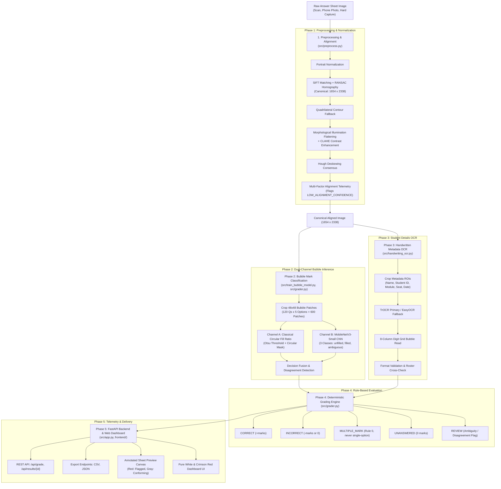

# System Architecture & Technical Specification

The **OMR Interpreter** is an end-to-end computer vision and machine learning pipeline designed to automatically align, read, and grade standard multiple-choice answer sheets (specifically the UCD S3231 examination form format).

---

## 1. High-Level Architecture Overview

---

## 2. Component Pipeline Details

### 2.1 Phase 1: Preprocessing & Canonical Alignment (`src/preprocess.py`)
1. **Orientation Correction:** Checks dimensions and aspect ratio; rotates landscape images by 90 or 270 degrees into portrait orientation.
2. **Feature-Based Homography:** Computes SIFT features on the input image and matches them against precomputed template keypoints. RANSAC computes a perspective transform matrix $H \in \mathbb{R}^{3 \times 3}$, warping the image to the canonical frame ($1654 \times 2338$ pixels, corresponding to A4 at 200 DPI).
3. **Geometric Fallback:** If SIFT inliers fall below acceptable thresholds, an adaptive contour detector locates the largest 4-sided convex polygon representing the page boundary and performs a quadrilateral perspective transform.
4. **Illumination Correction:** Normalizes severe lighting gradients and smartphone cast shadows using morphological background division (elliptical structuring element of size $51 \times 51$) followed by Contrast Limited Adaptive Histogram Equalization (CLAHE).
5. **Consensus Deskewing:** Applies probabilistic Hough line transform to detect dominant horizontal and vertical lines, correcting residual rotation skew within $\pm 2^\circ$.
6. **Alignment Confidence Telemetry:** Calculates a multi-factor score (0.0 to 1.0) incorporating SIFT inlier ratio, homography determinant condition, and edge gradient correlation. If the score falls below `0.65`, the sheet is tagged with `LOW_ALIGNMENT_CONFIDENCE` to warn examiners.

### 2.2 Phase 2: Bubble Mark Extraction & Inference
- **ROI Projection:** Based on `template.json`, coordinates are projected for 120 questions $\times$ 5 options (`A` through `E`) = 600 bubble locations, plus 8 columns $\times$ 10 digit bubbles for student numbers.
- **Dual Inference Channels:**
  - **Classical Baseline:** Extracts circular ROI, computes Otsu binarization, and measures fill ratio against a circular mask. Fill ratios $\ge 0.38$ indicate filled bubbles; ratios between $0.20$ and $0.42$ indicate ambiguous marks.
  - **MobileNetV3-Small Classifier:** 48x48 patches are evaluated by a fine-tuned MobileNetV3-Small network outputting probabilities across 3 classes: `unfilled`, `filled`, and `ambiguous`.
- **Decision Fusion Implementation:**
  - Identifies the highest filled candidate per question and measures relative margin against the second candidate.
  - Where the CNN predicts `filled` with high confidence ($>0.70$) and the classical fill ratio corroborates ($>0.30$), the option is marked as filled.
  - If the classical baseline and CNN disagree (e.g., fill ratio $>0.38$ but CNN predicts `unfilled`, or fill ratio $<0.20$ but CNN predicts `filled`), the question is flagged for `REVIEW`.

### 2.3 Phase 3: Handwritten Metadata OCR (`src/handwriting_ocr.py`)
- **Metadata Fields:** Name, Student Number (written), Module Code, Seat Number, Examination Date.
- **Dual Engine Execution:** Primary extraction uses TrOCR (`microsoft/trocr-base-handwritten`). If PyTorch MPS/CUDA memory is constrained or offline fallback is needed, EasyOCR runs as an offline fallback engine.
- **Bubble Digit Read:** The 8-digit student number is read from the bubble grid and cross-checked against handwritten OCR text.
- **Privacy Isolation:** Optional validation cross-checks student ID digits against `roster.csv` without ever logging, printing, or transmitting student names.

### 2.4 Phase 4: Deterministic Grader (`src/grader.py`)
Grading executes purely deterministic rules:
- **`CORRECT`:** Exactly one bubble marked matching the answer key. Awarded full marks (default: +1.0).
- **`INCORRECT`:** Exactly one bubble marked differing from the answer key. Deducted negative marks (if configured) or awarded 0.0.
- **`MULTIPLE_MARK`:** Two or more bubbles detected as filled for a single question. Strictly awarded 0.0 marks; never attributed to a single option.
- **`UNANSWERED`:** Zero bubbles detected as filled. Awarded 0.0 marks.
- **`REVIEW`:** Disagreements between classical fill ratio and neural classifier, faint pencil marks, or ambiguous symbols. Flags the question for human verification while preserving intermediate metrics.

### 2.5 Phase 5: FastAPI Backend & Web UI (`src/app.py`, `frontend/`)
- **REST Endpoints:**
  - `POST /api/grade`: Upload sheet image with optional scoring parameters and custom answer key (JSON or CSV).
  - `GET /api/results/{id}`: Retrieve structured grading report and question statuses.
  - `GET /api/export/{id}.csv` and `GET /api/export/{id}.json`: Download evaluation reports.
  - `GET /api/health`: Health status and device telemetry.
- **UI Design System:**
  - Pure white background (`#FFFFFF`) with crimson red accent palette (`#7F1D1D`, `#B91C1C`, `#DC2626`).
  - Zero emojis across all interface copy, status badges, and notifications.
  - High-resolution interactive canvas overlay highlighting flagged questions in red and conforming questions in neutral gray.
